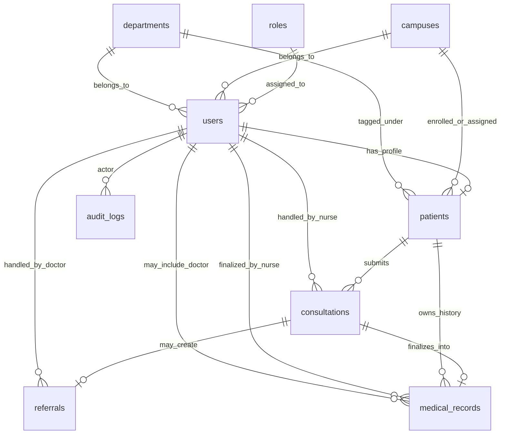

# HSMS Phase 1 Planning

## 1. System Direction

HSMS is a centralized on-premise web application for school clinic operations across multiple campuses.

Design constraints:
- Monolith only
- Laravel API backend (no Blade)
- React + TypeScript frontend
- MS SQL Server database
- Google OAuth login (school domain only)
- Role-based access control for Student, Employee, Nurse, Doctor, Admin

Engineering principles:
- Keep controllers thin
- Move business rules into service classes
- Keep schema normalized and readable
- Use migrations for all schema changes
- Prefer explicit status transitions over implicit behavior

## 2. Core Data Model (Normalized)

### 2.1 ERD (High-Level)

### 2.2 Table Blueprint

`roles`
- id (PK)
- name (unique) -> student, employee, nurse, doctor, admin
- description
- created_at, updated_at

`campuses`
- id (PK)
- code (unique)
- name
- address
- created_at, updated_at

`departments`
- id (PK)
- code (unique)
- name
- category (basic_education | college)
- created_at, updated_at

`users`
- id (PK)
- role_id (FK -> roles.id)
- campus_id (FK -> campuses.id)
- department_id (FK -> departments.id, nullable for some staff)
- google_sub (unique, OAuth subject)
- email (unique)
- first_name
- last_name
- is_active (bool)
- last_login_at (nullable)
- created_at, updated_at

`patients`
- id (PK)
- user_id (FK -> users.id, unique)
- patient_number (unique)
- sex
- birth_date
- contact_number
- emergency_contact_name
- emergency_contact_number
- created_at, updated_at

`consultations`
- id (PK)
- patient_id (FK -> patients.id)
- nurse_id (FK -> users.id, nullable until nurse picks case)
- consultation_type (walk_in | scheduled)
- status (see status flow)
- chief_complaint
- symptoms (text, nullable)
- triage_notes (text, nullable)
- referred_to_doctor (bool)
- submitted_at
- started_at (nullable)
- completed_at (nullable)
- created_at, updated_at

`referrals`
- id (PK)
- consultation_id (FK -> consultations.id, unique)
- doctor_id (FK -> users.id)
- status (pending_doctor | in_progress | completed)
- referral_reason
- doctor_remarks (nullable)
- prescription (nullable)
- referred_at
- completed_at (nullable)
- created_at, updated_at

`medical_records`
- id (PK)
- consultation_id (FK -> consultations.id, unique)
- patient_id (FK -> patients.id)
- nurse_id (FK -> users.id)
- doctor_id (FK -> users.id, nullable)
- summary
- final_diagnosis
- treatment_plan
- prescription (nullable)
- follow_up_date (nullable)
- finalized_at
- created_at, updated_at

`audit_logs`
- id (PK)
- user_id (FK -> users.id, nullable for system events)
- action
- entity_type
- entity_id
- old_values_json (nullable)
- new_values_json (nullable)
- ip_address (nullable)
- user_agent (nullable)
- created_at

### 2.3 Relationship Rules

- One user has one role.
- A patient record belongs to exactly one user.
- A consultation belongs to one patient and is optionally assigned to one nurse.
- A consultation can have at most one referral.
- A consultation finalizes to exactly one medical record.
- Medical records provide the historical timeline for patient care.
- All significant login and data-change events are written to audit logs.

## 3. Consultation and Referral Status Flow

### 3.1 Consultation Status Values

- `pending_consultation`: submitted by student or employee, waiting for nurse review
- `nurse_assessment`: nurse is currently handling case
- `referred_to_doctor`: nurse marked case for doctor referral
- `nurse_finalization`: doctor completed referral, waiting for nurse to finalize medical record
- `completed`: case fully completed and medical record finalized
- `cancelled`: invalid or withdrawn case

### 3.2 Referral Status Values

- `pending_doctor`: referral created, waiting for doctor action
- `in_progress`: doctor currently assessing referral
- `completed`: doctor submitted remarks and prescription

### 3.3 Valid State Transitions

Consultation:
- `pending_consultation -> nurse_assessment`
- `nurse_assessment -> completed` (no referral path)
- `nurse_assessment -> referred_to_doctor` (referral path)
- `referred_to_doctor -> nurse_finalization` (after doctor completes referral)
- `nurse_finalization -> completed`
- `pending_consultation -> cancelled`
- `nurse_assessment -> cancelled`

Referral:
- `pending_doctor -> in_progress`
- `in_progress -> completed`

Business constraints:
- Consultation cannot become `completed` unless a `medical_records` row is written.
- If consultation is `referred_to_doctor`, referral must exist and be `completed` before nurse finalization.
- Only nurse can move consultation to `completed`.
- Only doctor can move referral to `completed`.

## 4. Roles and Permissions (Phase 1 Definition)

### 4.1 Role Scope

Student:
- View own profile
- Submit consultation forms
- View own consultation history and status

Employee:
- View own profile
- Submit consultation forms
- View own consultation history and status

Nurse:
- View queue of pending consultations
- Verify patient registration and identity flags
- Start and complete non-referred consultations
- Create referrals for doctor
- Finalize consultation and medical record after doctor response
- Access patient search and report dashboards
- Print prescriptions and report views (as permitted)

Doctor:
- View assigned referrals
- Add remarks and prescription
- Mark referral as completed
- View relevant patient consultation context

Admin:
- Manage users, campuses, departments, and role assignment
- View global dashboards and reports
- View audit logs
- Configure allowed school email domain and system settings

### 4.2 Permission Matrix (Module-Level)

| Module / Action | Student | Employee | Nurse | Doctor | Admin |
|---|---|---|---|---|---|
| Login via Google OAuth | Yes | Yes | Yes | Yes | Yes |
| Submit consultation form | Yes | Yes | No | No | No |
| View own consultations | Yes | Yes | No | No | No |
| View all consultations queue | No | No | Yes | No | Yes |
| Update consultation status (nurse steps) | No | No | Yes | No | Yes |
| Create referral | No | No | Yes | No | Yes |
| Manage referral remarks/prescription | No | No | No | Yes | Yes |
| Finalize medical record | No | No | Yes | No | Yes |
| View reports and disease stats | No | No | Yes | Limited | Yes |
| Print prescription/report | No | No | Yes | Yes | Yes |
| Manage users and roles | No | No | No | No | Yes |
| View audit logs | No | No | Limited | No | Yes |

## 5. Functional Module Checklist

### 5.1 Student and Employee Module

- Submit consultation form
- Track consultation status
- View own consultation history

### 5.2 Nurse Dashboard Modules

Main Dashboard:
- Total registered patients
- Today's consultations
- Completed consultations
- Completed walk-in and scheduled consultations
- Completed doctor referrals
- Recent activity feed

Search Dashboard:
- Filter registered patients by type: student or employee
- Search and review patient details

Reports Dashboard:
- Monthly total consultations chart
- Disease statistics chart
- Department filter: basic education or college
- Printable report views

Print Dashboard:
- Printable prescriptions

About Dashboard:
- HSMS system information

### 5.3 Doctor Module

- View referral queue
- Add remarks and prescription
- Mark referral as completed

### 5.4 Admin Module

- User and role administration
- Campus and department administration
- Global reporting oversight
- Audit log monitoring

## 6. Reporting Coverage Mapping

Required reports and their source:
- Monthly consultation totals -> `consultations.submitted_at`, grouped by month
- Disease statistics -> `medical_records.final_diagnosis`, grouped by diagnosis label/code
- Filter by department -> join `medical_records -> patients -> users -> departments`
- Print output -> use backend report endpoints with printable frontend views

## 7. Security and Audit Baseline

Security requirements to enforce from Phase 2 onward:
- RBAC middleware for all protected routes
- Domain-restricted OAuth login (school email only)
- Request validation on create and update endpoints
- Rate limiting for auth and sensitive endpoints
- Server-side authorization checks even if frontend hides actions

Audit events to capture:
- Login success and failure
- Consultation create, status change, completion, cancellation
- Referral create, update, completion
- Medical record finalize and update
- User and role administration actions

## 8. Phase Sequence and Exit Criteria

### Phase 1 - Planning (current)
Exit criteria:
- ERD agreed
- Relationship rules agreed
- Consultation and referral status transitions locked
- Role permissions matrix approved

### Phase 2 - Backend Foundation
Exit criteria:
- Laravel API app initialized
- SQL Server connection verified
- Core migrations and models created
- Versioned API routes and RBAC middleware in place

### Phase 3 - Authentication
Exit criteria:
- Google OAuth implemented
- School email domain restriction enabled
- Role mapping on login complete
- JWT issuance and refresh strategy defined

### Phase 4 - Core Modules
Exit criteria:
- Patient registration flow complete
- Consultation create and queue workflow complete
- Referral workflow complete
- Medical record finalization complete
- Audit logs emitted for sensitive actions

### Phase 5 - Frontend Integration
Exit criteria:
- Role-based dashboards connected to API
- Nurse, doctor, and admin core screens functional
- Patient submission and history views working
- Report charts integrated

### Phase 6 - Reporting and Printing
Exit criteria:
- Monthly and disease reports accurate
- Department filters working
- Printable prescriptions and reports available

### Phase 7 - Testing and Hardening
Exit criteria:
- Role-based tests pass
- Workflow tests pass for referral and non-referral paths
- Security checks pass for authz and protected endpoints
- Technical documentation updated

## 9. Immediate Next Step (Phase 2 Start)

Implementation order for next work session:
1. Initialize Laravel API project structure.
2. Configure SQL Server environment and database connection.
3. Create migrations in dependency order: roles, campuses, departments, users, patients, consultations, referrals, medical_records, audit_logs.
4. Create Eloquent models with explicit relationships.
5. Add API route groups and RBAC middleware skeleton.
